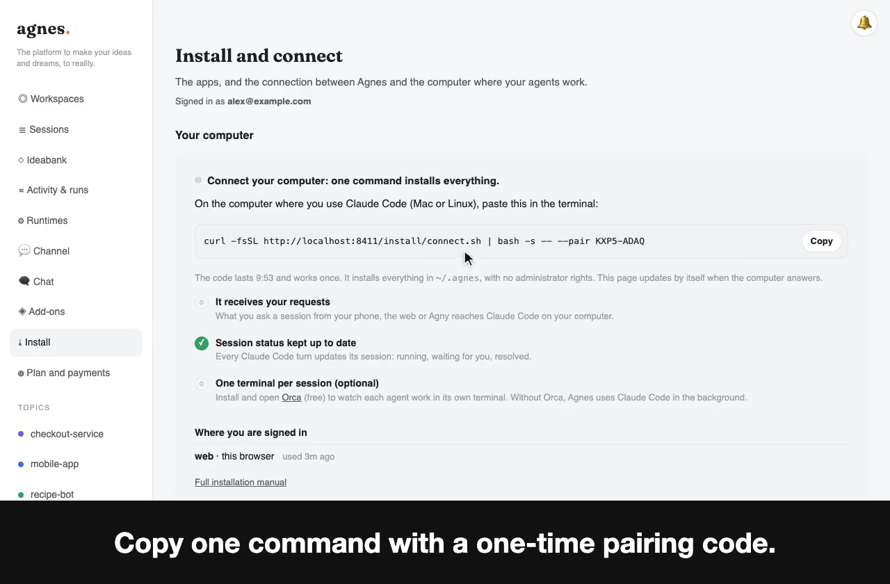
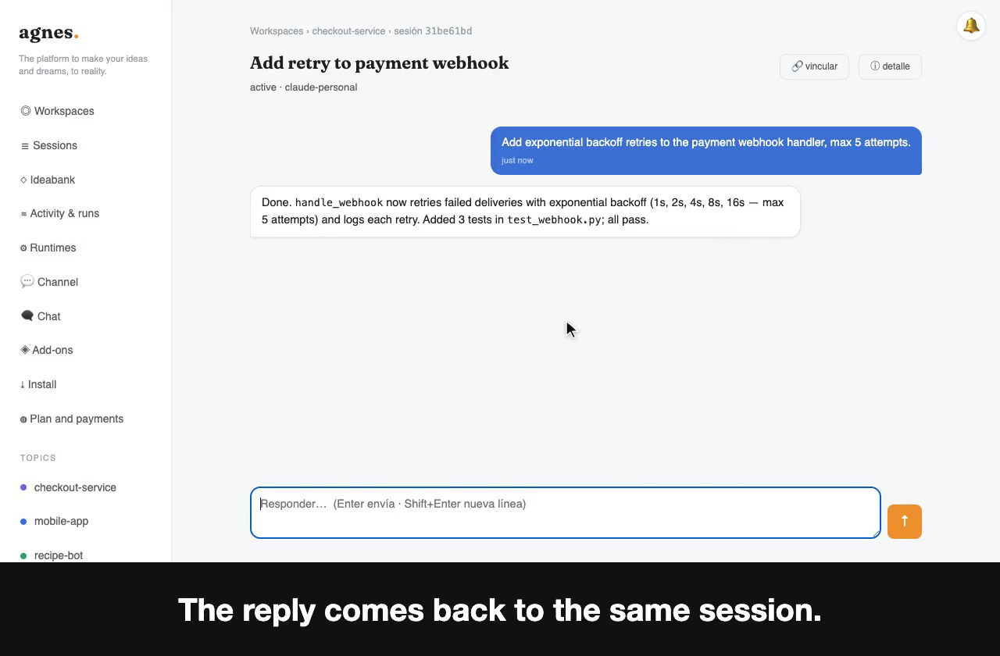
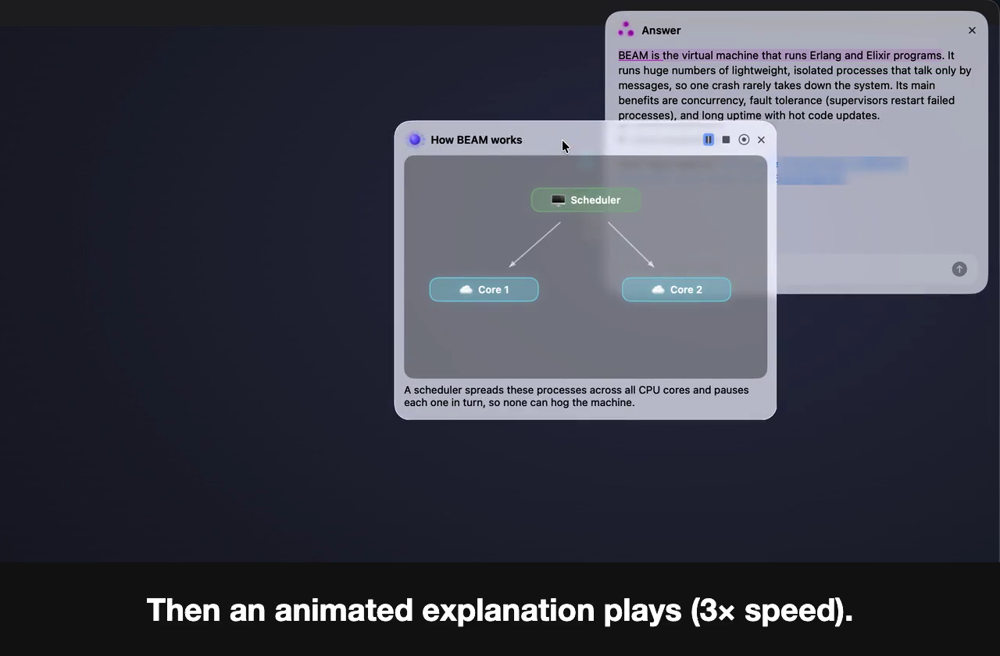
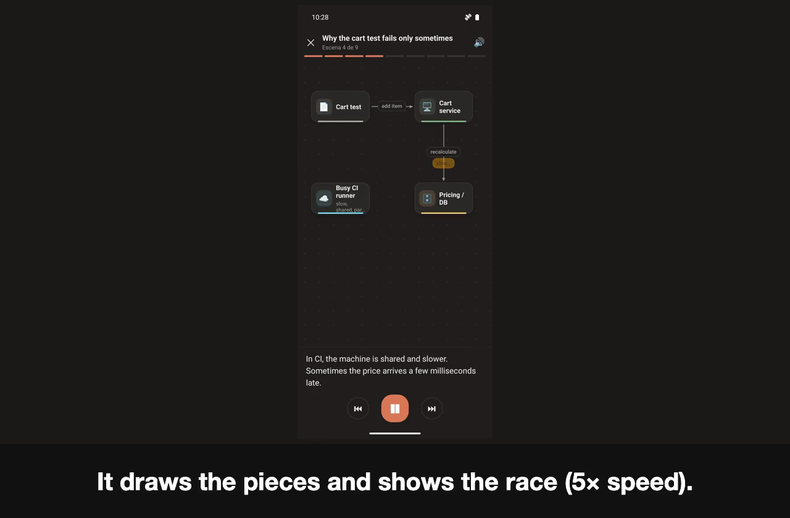
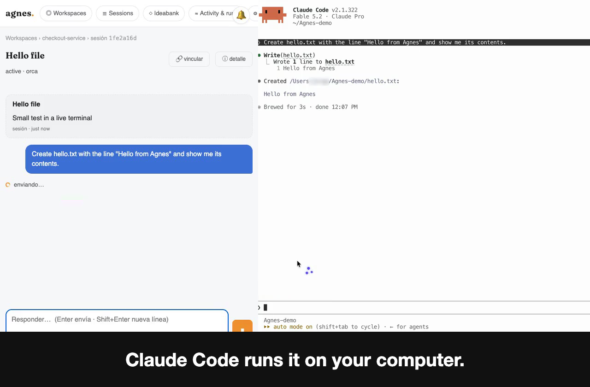
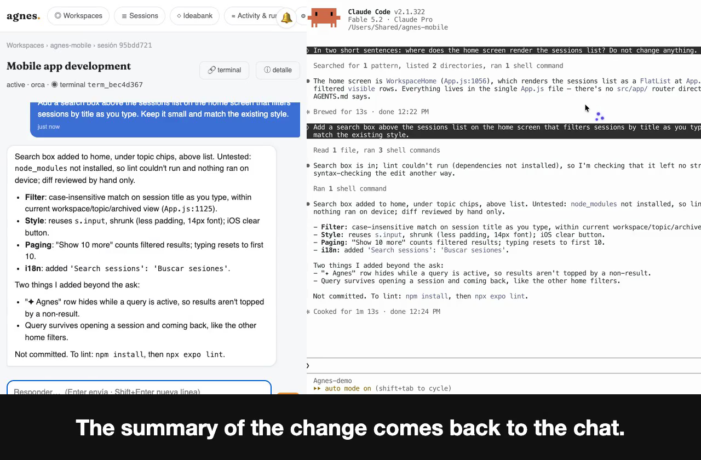
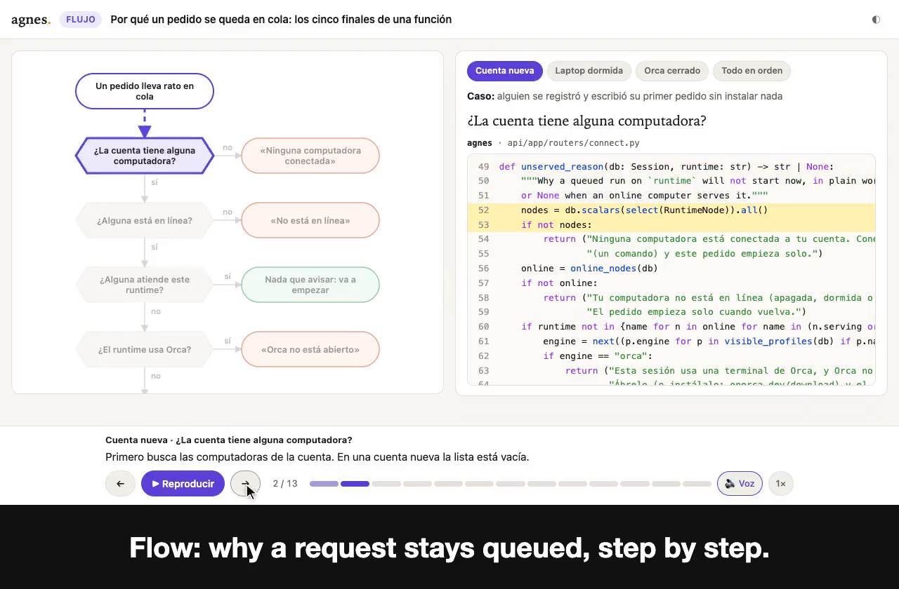
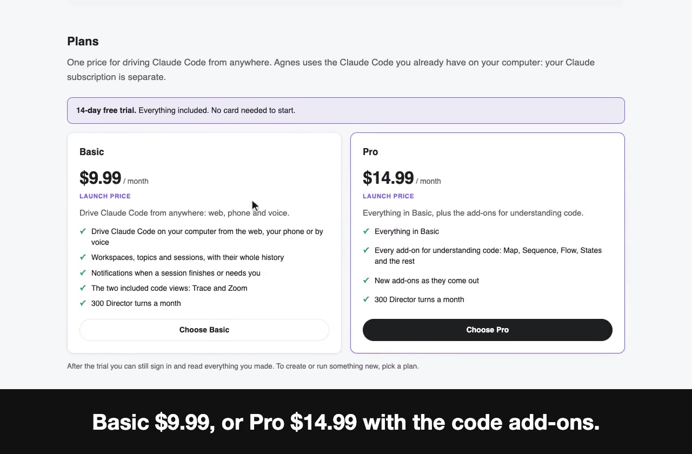

# Agnes guide

Agnes lets you ask Claude Code for things from your phone, the web or your voice, and have them run on your own computer. You follow each request as a session and get the reply back where you asked.

Agnes started from the idea of an agent that keeps working until a hard problem is solved (the Ralph Loop in Claude Code). It adds one thing: a human in the loop whenever it's really needed. So the agent goes and finds you, wherever you are.

This guide covers how to use Agnes. Start at **[agnes.fractalcode.xyz](https://agnes.fractalcode.xyz)**.

- [What you need](#what-you-need)
- [Get started](#get-started)
- [Ask from anywhere](#ask-from-anywhere)
- [Sessions](#sessions)
- [Watch it work in a live terminal](#watch-it-work-in-a-live-terminal-optional)
- [Understand code with views](#understand-code-with-views)
- [Plans](#plans)
- [Managing the connection](#managing-the-connection)
- [If a request doesn't start](#if-a-request-doesnt-start)
- [Language](#language)
- [Demo videos](#demo-videos)

## What you need

- A Mac or Linux computer with [Claude Code](https://claude.com/claude-code) installed and signed in. Your Claude subscription is separate from Agnes.
- `python3` on that computer.
- An Agnes account. The 14-day trial needs no card.

## Get started

### 1. Sign in

Go to [agnes.fractalcode.xyz](https://agnes.fractalcode.xyz) and enter your email. Agnes sends you a 6-digit code, valid for 15 minutes. You stay signed in for 90 days.

You can also set a password of 10 or more characters. If you forget it, "Forgot your password?" emails you a reset link.

### 2. Connect your computer

[](demo/03-connect-one-command-en.mp4)

1. Open **Install** in the side menu.
2. Copy the command it shows. It carries a one-time pairing code that lasts 10 minutes:

   ```bash
   curl -fsSL https://agnes.fractalcode.xyz/install/connect.sh | bash -s -- --pair XXXX-XXXX
   ```

3. Paste it in a terminal on the computer where you use Claude Code.
4. The Install page turns green by itself when your computer answers.

Everything installs into `~/.agnes`, with no administrator rights. Without a pairing code, the command asks for your email and a sign-in code.

After connecting, open a **new** Claude Code session so it picks up the connection.

### 3. Send your first request

[](demo/01-ask-from-anywhere-en.mp4)

Open a session, type what you want, and send it. Claude Code runs it on your computer and the reply comes back to the same session.

## Ask from anywhere

| Where | How |
|---|---|
| **Web** | [agnes.fractalcode.xyz](https://agnes.fractalcode.xyz) in any browser, on any device. You see your workspaces and the sessions in each one. |
| **Android** | The Agnes app. Sign in with your email, allow the microphone and notifications, and tap **Talk to Agnes** to speak a request. Agnes picks the session it belongs to, or asks you. |
| **Mac (Agny)** | A voice assistant in the menu bar, for macOS 26. Hold `⌥Z`, speak, and release to send. Hold `⌥1`–`⌥9` to speak straight into a saved session. |

Your computer has to be on and connected for a request to run. You can send the request from somewhere else.

### Talk to Agny on the Mac

Hold a key, ask out loud, and Agny reads the answer back while it highlights each line. If the answer has a visual explanation, it plays in its own window.

[](demo/07-agny-voice-en.mp4)

### Ask from your phone

Open a session in the Android app and ask about your code. When the answer explains something visually, the app plays it as a narrated cinematic: the pieces appear, the code that matters lights up, and the voice walks you through it.

[](demo/08-mobile-cinematic-en.mp4)

## Sessions

Each request lives in a session. A session is in one of three states:

- **Running**: Claude Code is working on it.
- **Waiting for you**: it needs your answer before it can continue.
- **Resolved**: done.

A session closes by itself after 3 hours with no activity. Sessions are grouped into topics. A session that doesn't belong to a topic goes to the **Auto** topic.

## Watch it work in a live terminal (optional)

[](demo/05-orca-live-terminal-en.mp4)

By default Claude Code works in the background. To watch each session in its own terminal, install [Orca](https://onorca.dev/download) (free) and keep it open. A request from the chat then opens a live Claude Code terminal, and the reply still returns to the chat.

Download Orca from onorca.dev. The Homebrew package named `orca` is a different program.

### Use a terminal you already have open

[](demo/06-orca-existing-session-en.mp4)

You can also link a session to a Claude Code terminal that is already open in Orca. In the session, use **link** and pick the terminal. What you ask from the chat then runs in that terminal, and the summary comes back to the chat.

## Understand code with views

[](demo/02-understands-code-en.mp4)

Ask Claude Code for a view by name and Agnes gives you a narrated page you can share. Move through it with the arrow keys and the spacebar.

| View | What it shows |
|---|---|
| **Trace** | One execution, step by step. |
| **Zoom** | From the idea, to the steps, to the code. |
| **Map** | The pieces, and the journey of a request through them. |
| **Sequence** | Who talks to whom, in order. |
| **Predict** | A quiz that asks you before it shows you. |
| **Flow** | The paths the code can take. |
| **States** | The states something goes through and what moves it between them. |
| **Morph** | A value changing shape as it moves through the code. |
| **Impact** | What a change would touch. |
| **Skyline** | The shape of a file at a glance. |

See examples at [agnes.fractalcode.xyz/view](https://agnes.fractalcode.xyz/view).

Trace and Zoom are included in every plan. The other views are add-ons, and the trial includes all of them. Opening a view someone shared with you is always free.

## Plans

[](demo/04-plans-en.mp4)

| Plan | Price | Includes |
|---|---|---|
| **Free trial** | 14 days, no card | Everything, including all add-ons. |
| **Basic** | USD 9.99 / month | Claude Code from the web, your phone and your voice; your workspaces and sessions; notifications; the Trace and Zoom views; 300 Director turns a month. |
| **Pro** | USD 14.99 / month | Everything in Basic, all the code add-ons, and unlimited Director turns. |

These are launch prices. Your Claude subscription is separate: Agnes uses the Claude Code you already have.

When the trial ends without a plan, you can still sign in and read everything you did, and the links you shared still open. You can't create or run anything new.

**Plan and payments** on the web shows your plan, this month's usage and your receipts. You change plan or stop renewing there. If you stop renewing, the plan lasts until the end of what you paid for.

## Managing the connection

Run the same command with a different ending:

| To | Use |
|---|---|
| Check the connection | `curl -fsSL https://agnes.fractalcode.xyz/install/connect.sh \| bash -s -- --status` |
| Update | Run the connect command again. |
| Remove it | `curl -fsSL https://agnes.fractalcode.xyz/install/connect.sh \| bash -s -- --uninstall` |

## If a request doesn't start

- **No computer connected.** Open **Install** and run the connect command.
- **Your computer is off, asleep or offline.** Wake it and check with `--status`.
- **Claude Code is missing or signed out.** Open Claude Code on that computer and sign in.
- **You use Orca mode and Orca isn't open.** Open Orca.

## Language

Agnes is available in English and Spanish. Switch with the **EN / ES** buttons. The choice is saved to your account, and emails and notifications arrive in that language.

## Demo videos

The short videos used on the Agnes site are in [`demo/`](demo/). Each one has an `.mp4`, a `.webm`, a `.png` poster and `.vtt` captions. They have no audio, except where noted, and the captions are burned in.

| Video | File |
|---|---|
| Ask from anywhere | [`01-ask-from-anywhere-en`](demo/01-ask-from-anywhere-en.mp4) |
| Agnes understands code | [`02-understands-code-en`](demo/02-understands-code-en.mp4) |
| Connect with one command | [`03-connect-one-command-en`](demo/03-connect-one-command-en.mp4) |
| Plans | [`04-plans-en`](demo/04-plans-en.mp4) |
| Live terminal with Orca | [`05-orca-live-terminal-en`](demo/05-orca-live-terminal-en.mp4) |
| Link a session to an open terminal | [`06-orca-existing-session-en`](demo/06-orca-existing-session-en.mp4) |
| Agny, voice on the Mac | [`07-agny-voice-en`](demo/07-agny-voice-en.mp4) |
| Agny, voice on the Mac, with the spoken request (audio) | [`07-agny-voice-audio-en`](demo/07-agny-voice-audio-en.mp4) |
